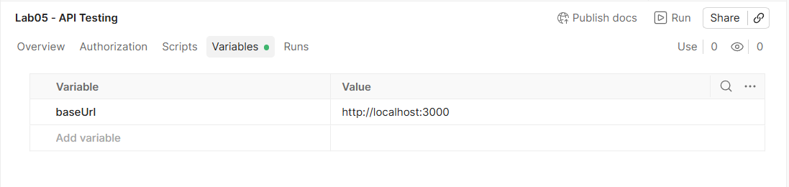
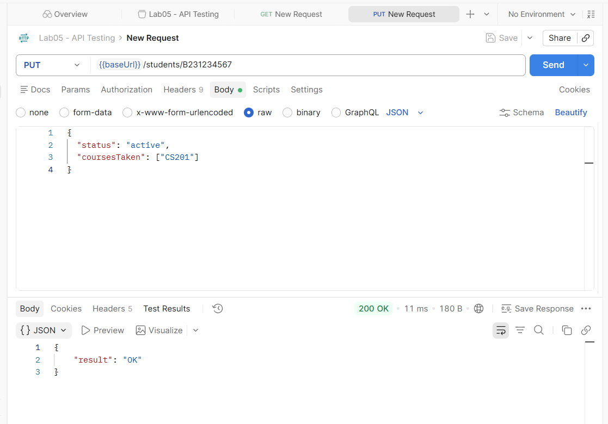
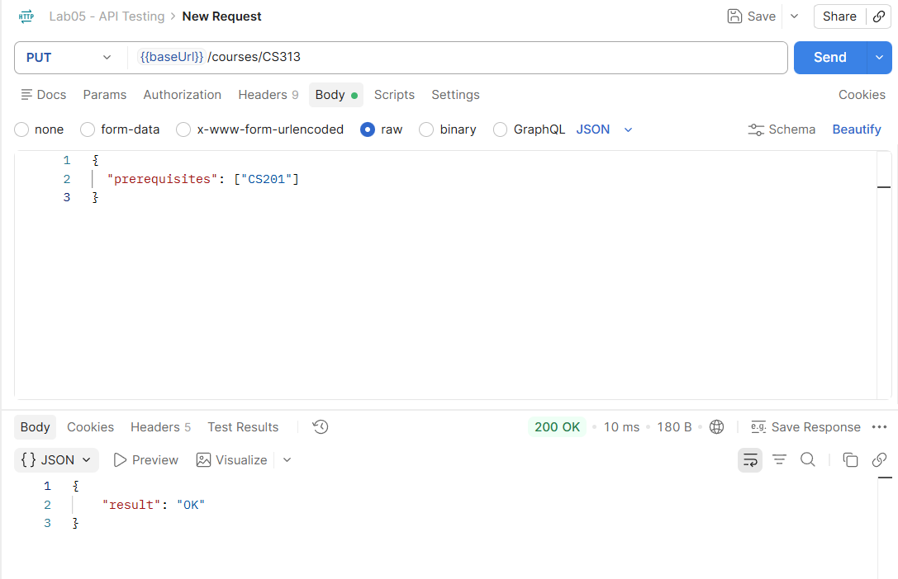
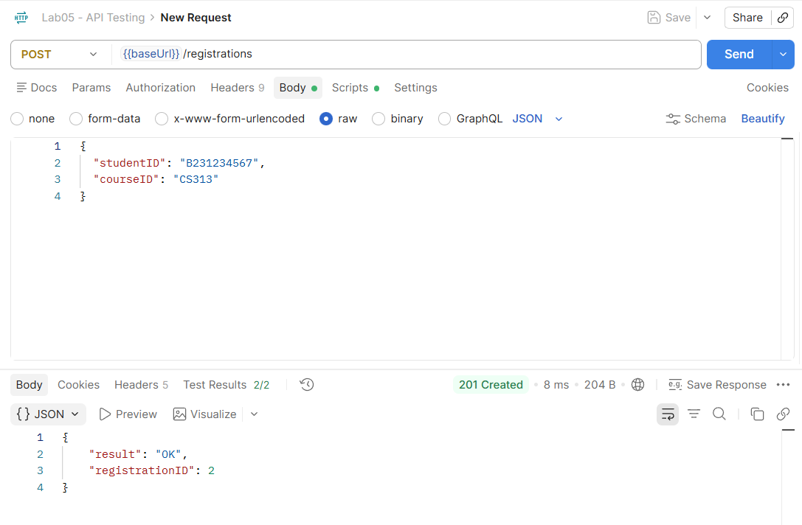
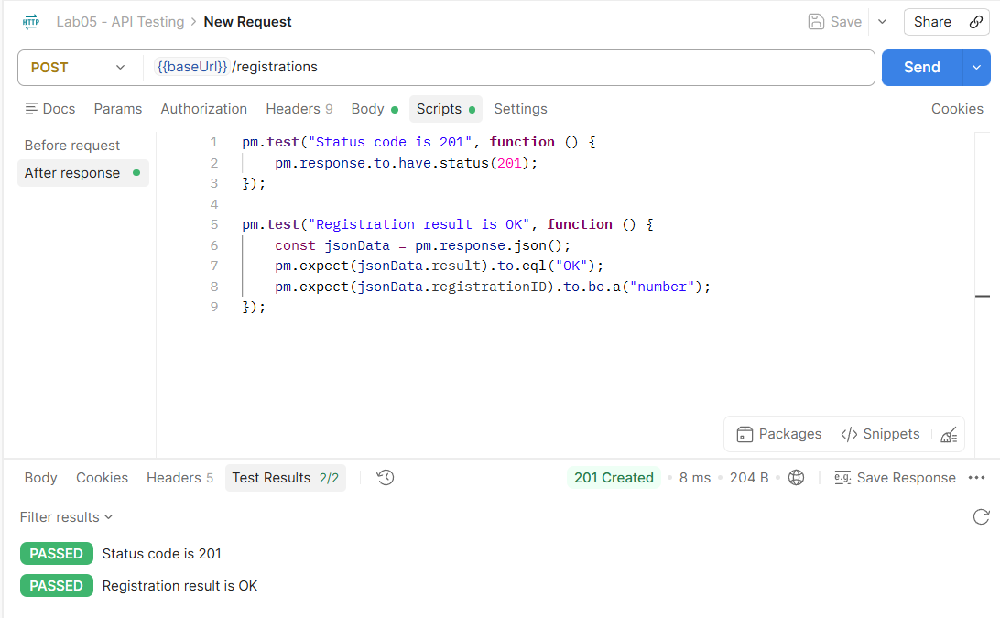

# Lab 05 — API систем тест: Postman ба Newman

**Оюутны нэр:** Т.Мөнхцэцэн  
**Оюутны код:** B232270025

## 1. Ажлын орчин

- **Node.js хувилбар:** `v24.18.1`
- **Newman хувилбар:** `6.2.2`
- **API хаяг:** `http://localhost:3000`
- **API тестийн хэрэгсэл:** Postman
- **Автомат тест ажиллуулах хэрэгсэл:** Newman

## 2. Анхны хүсэлт ба oracle

### 1. {{baseUrl}} collection variable ашигласан:

### 2. PUT /students/B231234567 хүсэлтээр идэвхтэй, CS201 үзсэн оюутан үүсгэсэн:

### 3. PUT /courses/CS313 хүсэлтээр CS201 урьдач нөхцөлтэй хичээл үүсгэсэн:

### 4. POST /registrations хийж 201 ба result="OK" ирж буйг ХОЁР pm.test oracle-оор шалгасан:

## 3.
